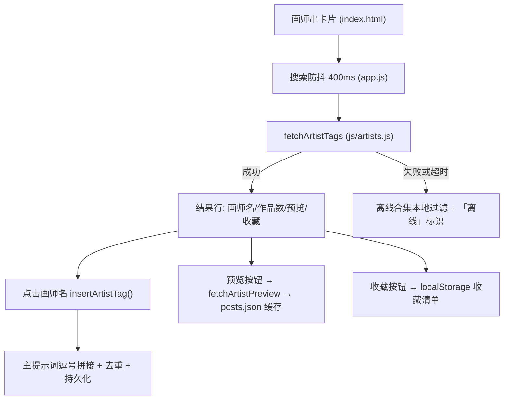

# 技术设计：Danbooru 画师串源库

Feature Name: danbooru-artist-library
Updated: 2026-11-07

## 描述

左面板新增「画师串源库 (Danbooru)」折叠卡片：防抖搜索画师标签、按需展开代表图缩略图、一键插入主提示词 (去重)、localStorage 收藏管理。画师库地址可配置 (默认 Danbooru 官方)，请求失败自动回退内置离线合集。

## 架构



纯前端直连画师库，与图像生成走的中转站完全独立。沙箱环境已验证到 `danbooru.donmai.us` 直连重置，浏览器端由用户本机网络决定连通性，故地址可配置 + 离线兜底。

## 组件与接口

### 1. js/artists.js (新文件，脚本顺序位于 api.js 之后 app.js 之前)

| 成员 | 职责 |
|------|------|
| `OFFLINE_ARTISTS` | 内置常用画师合集 `{ name, note }`，仅收录高置信度 Danbooru 标签 |
| `normalizeArtistBase(base)` | 补全 https 前缀、去尾部斜杠，空值回默认官方地址 |
| `buildArtistTagsUrl(base, q)` | tags.json 搜索 URL (category=1 画师， order=count, limit=20) |
| `buildArtistPostsUrl(base, tag)` | posts.json 预览 URL (limit=3) |
| `fetchArtistTags(base, q)` | GET tags.json → `[{name, post_count}]`，超时 10s |
| `filterOfflineArtists(q)` | 离线合集按 name/note 子串 (忽略大小写) 过滤 |

### 2. index.html

- 卡片位置：「排除内容」之后、「氛围转移」之前；复用 `card collapsible` / `hint-btn` / `field-hint` / `mini-btn` 范式
- 元素：`artistSearch` 搜索框、`artistHint` 提示位、`artistResults` 结果容器、`artistFavBlock` 收藏区 (含清空按钮)
- 设置弹窗「模型」字段之后新增 `artistBase` 输入项

### 3. app.js

- `DEFAULT_SETTINGS` 增加 `artistBase: "https://danbooru.donmai.us"`；设置保存/回填绑定
- `bindArtistLibrary()`：防抖搜索 (400ms, AbortController 取消旧请求)、结果渲染、预览切换、收藏绑定；`init()` 注册
- `insertArtistTag(name)`：按逗号拆分主提示词，忽略大小写去重，存在则 toast 警告，追加后同步字数与 `saveParams()`
- 收藏：`LS_ARTIST_FAVS = "nai_clone_artist_favs"`，`loadArtistFavs/saveArtistFavs/renderArtistFavs`，收藏项点击即插入
- 预览缓存：内存 `Map<tag, string[]>`，同一会话免重复请求；`img.onerror` 隐藏坏图
- 作品数格式化：`12345 → 12.3k`；离线合集无计数显示「≈」

### 4. css/style.css

`.artist-results` / `.artist-row` / `.artist-name`(标签 chip 样式) / `.artist-count` / `.artist-thumbs`(3 列缩略图) / `.artist-favs`(chip 流式布局)，复用现有变量 `--bg-elev` / `--border-strong` / `--accent` / `--radius-sm`。

## 数据模型

```js
// 搜索结果行 (在线)
{ name: "as109", post_count: 12345 }
// 搜索结果行 (离线兜底)
{ name: "as109", post_count: null, note: "构图光影概念", offline: true }
// 收藏 (localStorage)
[{ name: "as109", postCount: 12345 }]
```

## 正确性属性

1. 插入去重：同一画师 (忽略大小写) 重复插入时主提示词内容保持不变。
2. 插入后 `params.prompt`、字数显示、localStorage 三者一致。
3. 收藏清单跨刷新保留，移除与清空即时生效。
4. 防抖期间连续输入仅发起最后一次请求，AbortController 取消前一请求。
5. 画师库地址变更后，搜索与预览请求均指向新地址。
6. 离线回退路径的请求零外发。

## 错误处理

| 场景 | 处理 |
|------|------|
| 画师库请求失败/超时 (10s) | hint 显示「画师库连接失败，已切换到内置离线合集」，结果来自本地过滤 |
| 预览图加载失败 | 隐藏该缩略图，其余保留 |
| 插入重复画师 | toast「该画师已在提示词中」，内容不变 |
| 收藏重复画师 | 提示已收藏，清单不变 |

## 测试策略

1. Node 冒烟测试 (vm 加载 js/artists.js)：URL 构建 (前缀补全/斜杠归一/参数编码)、离线过滤 (中英文关键词/忽略大小写)。
2. 浏览器手测清单：搜索插入去重、预览展开折叠、收藏持久化、设置改地址、断网回退离线合集。

## 参考

[^1]: (Filename#L43) - index.html:43-47 折叠卡片范式
[^2]: (Website) - [Danbooru API - Tags](https://danbooru.donmai.us/wiki_pages/help%3Aapi) tags.json / posts.json 接口
