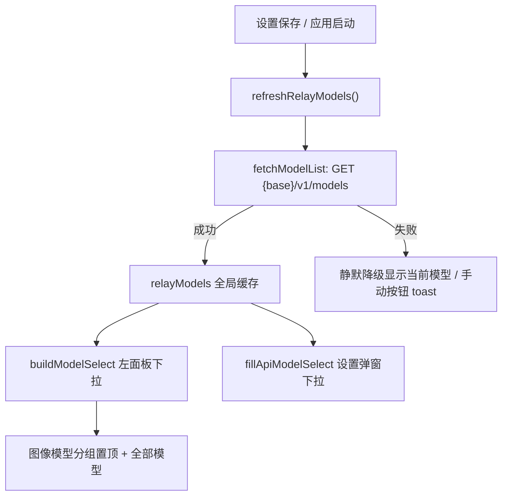

# 技术设计：中转站模型源改造与 Anlas 移除

Feature Name: relay-model-source
Updated: 2026-11-08

## 描述

模型下拉改为中转站动态源：启动与设置保存后自动请求 `{Base URL}/v1/models`，图像模型启发式分组置顶；内置模板清单退出 UI 来源（`NAI_MODELS` 仅保留作家族判定与显示名数据）。Anlas 估算全链路移除。

## 架构



## 组件与接口

### api.js
- 删除 `OPENAI_MODELS`、`estimateAnlas()`
- 新增 `looksLikeImageModel(id)`：`/(nai|diffusion|dall-?e|flux|stable|sd[0-9]|sdxl|seedream|kolors|cogview|gpt-image|image)/i`
- `NAI_MODELS` 保留：家族判定 + 已知 id 显示名，退出下拉来源
- `fetchModelList()` 复用为两种格式统一的拉取入口

### app.js
- 新增 `let relayModels = []` 与 `refreshRelayModels(opts)`：manual 失败 toast、silent 静默、成功重建两个下拉
- `buildModelSelect()` 重写：relayModels 分组渲染，空列表降级显示当前生效模型；change 处理器保留（清除自定义名、采样器联动、持久化）
- `updateModelSelectView()` 回退值由 `NAI_MODELS[0].id` 改为当前生效模型；`__custom__` 伪选项逻辑保留
- `fillApiModelSelect()` 重写：动态分组 + 「当前: x」插入；`fetchModelsBtn` 改为「重新拉取模型列表」手动刷新入口（两种格式通用）
- `reuseParams()` 已知模型判定改为 `relayModels.includes || NAI_MODELS.some`
- 设置保存后触发 `refreshRelayModels()`；`init()` 在已配置 base 时静默拉取
- 删除 `updateAnlas()` 及全部调用点（模型切换/尺寸/滑杆/数量/复用/初始化）

### index.html
- 移除顶栏 `anlasChip`；生成提示改为「Ctrl + Enter 快速生成」
- 左面板「画风引擎」与设置弹窗「模型」hint 文案改为动态拉取说明
- `fetchModelsBtn` 文案「重新拉取模型列表」

### css/style.css
- 移除 `.anlas-chip` 及其子规则

## 数据模型

```js
let relayModels = [];        // 中转站 /v1/models 返回的模型 id 列表 (运行时缓存, 不持久化)
settings.model / params.model  // 生效模型 id, 语义不变
settings.customModel         // 自定义模型名, 非空时优先
```

## 正确性属性

1. 生效模型恒为 `settings.customModel || settings.model || params.model`，下拉展示与其一致。
2. 拉取失败时下拉恒可显示当前模型，载荷构建路径 (modelFamily / isV45 正则) 不受列表影响。
3. Anlas 相关 DOM / 函数 / 调用点零残留。
4. 氛围转移与生成载荷行为与 main 分支一致 (回归测试通过)。

## 错误处理

| 场景 | 处理 |
|------|------|
| 启动自动拉取失败 | 静默, 下拉显示当前模型, 设置弹窗可手动重拉 |
| 手动重拉失败 | toast 错误信息, 保留现有列表 |
| 模型 id 无图像匹配 | 单组平铺, 全部可选 |

## 测试策略

1. Node 冒烟: `looksLikeImageModel` / `modelFamily` 对中转站风格 id 的判定; 既有 vibe 载荷回归。
2. 浏览器手测: 保存设置自动拉取分组、自定义模型名优先、断网降级、Anlas 移除后无报错。

## 参考

[^1]: (Filename#L1) - js/api.js:1-13 NAI_MODELS 与 OPENAI_MODELS
[^2]: (Filename#L92) - js/api.js:92 buildNaiPayload 家族判定链路
