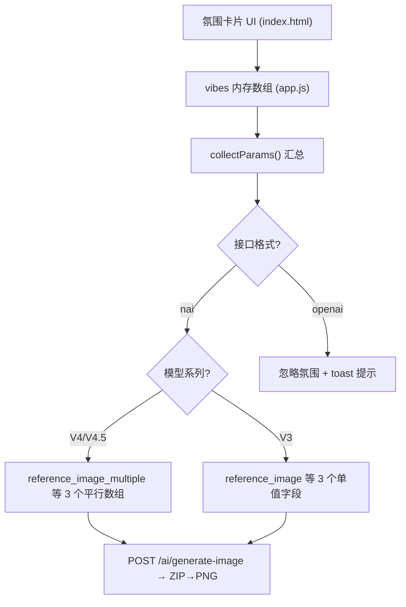

# 技术设计：氛围转移 (Vibe Transfer)

Feature Name: vibe-transfer
Updated: 2026-11-07

## 描述

在左面板新增「氛围转移」折叠卡片，用户可上传最多 5 张参考图并分别设置 信息提取强度 (Information Extracted, 0~1, 默认 1.0) 与 参考强度 (Reference Strength, 0~1, 默认 0.6)。生成时按模型系列填充 NovelAI 官方载荷字段：V4/V4.5 填三个平行数组，V3 填单值字段。仅作用于 NovelAI 官方格式；OpenAI 兼容格式下忽略并提示。氛围图仅存内存，刷新清空。

## 架构



数据流与现有图生图完全同构：上传 → FileReader → Image 解码 → base64 入内存 → `collectParams()` → `buildNaiPayload()` → 中转站。

## 组件与接口

### 1. index.html — 氛围转移卡片

位置：`排除内容` 卡片之后、`多角色设定` 卡片之前（对齐官方 UI 顺序）。结构复用现有模式：

- `card collapsible open` + `data-collapse-toggle`（同多角色设定卡片）
- `hint-text`「?」大白话注释
- `upload-box` (`id="vibeUploadBox"` + `vibeFileInput` multiple) 作为唯一新增入口：点击 / 拖拽 / Ctrl+V 粘贴
- `field-hint` 两个动态提示位：`vibeLimitHint`（达上限 / V3 单图限制 / OpenAI 格式忽略）、`vibeCount`
- `vibeList` 容器渲染氛围卡片

### 2. app.js — 状态与交互

新增运行时状态（与 `sourceImage` 同级，js/app.js:63-66 附近）：

```js
const VIBE_LIMIT = 5;
let vibes = [];  // { id, b64, dataUrl, infoExtracted: 1.0, referenceStrength: 0.6 }
```

新增函数，遵循现有命名与绑定风格：

| 函数 | 职责 |
|------|------|
| `bindVibeTransfer()` | 绑定上传区 click/drag/drop/change，init 时渲染 |
| `addVibeFiles(files)` | 逐个解码入列，超限截断并 toast，非图像跳过 |
| `renderVibeList()` | 渲染缩略图 + 移除按钮 + 两个滑杆（复用 char-card/slider-field 样式），更新提示位与上传区可见性 |
| `updateVibeHints()` | V3 多图提示、达上限提示、OpenAI 格式忽略提示 |

改动点：

- `bindImageUpload()` 现有全局 paste 处理（js/app.js:457-461）：凭空画模式下粘贴图改为加入氛围列表；照图改/局部重绘维持进源图
- `collectParams()`（js/app.js:944-979）追加 `vibes: vibes.map(v => ({ b64, infoExtracted, referenceStrength }))`
- `generate()`（js/app.js:1012）在 `settings.format === "openai" && p.vibes.length` 时 toast 警告并继续
- `init()` 注册 `bindVibeTransfer()`
- 模型切换 / 设置保存后的联动：`updateVibeHints()`（模型系列变化影响提示）
- `buildMeta()` 与 `reuseParams()` 源图一样不携带氛围图（刷新即清空，历史复用提示重新上传）

### 3. api.js — 载荷构建

`buildNaiPayload()`（js/api.js:92-197）改造 V4/V3 分支：

```js
const vibes = (p.vibes || []).filter((v) => v.b64);
if (isV4) {
  params.reference_image_multiple = vibes.map((v) => v.b64);
  params.reference_information_extracted_multiple = vibes.map((v) => +v.infoExtracted);
  params.reference_strength_multiple = vibes.map((v) => +v.referenceStrength);
} else {
  if (vibes.length) {
    params.reference_image = vibes[0].b64;
    params.reference_information_extracted = +vibes[0].infoExtracted;
    params.reference_strength = +vibes[0].referenceStrength;
  }
}
```

V4 分支原三个空数组赋值（js/api.js:146-148）替换为条件填充，空列表时仍为 `[]`，与现状完全兼容。V3 分支氛围列表为空时省略字段。`buildOpenAiPayload()` 零改动。

### 4. css/style.css — 样式

新增 `.vibe-list`、`.vibe-card`、`.vibe-thumb`，复用 `--card-bg`、`char-card` 的圆角/内距变量与 `slider-field` 滑杆行布局；缩略图 `object-fit: cover` 定高显示。

## 数据模型

```js
// 运行时氛围项（不持久化）
{
  id: "<crypto.randomUUID()>",
  b64: "<PNG/JPEG base64, 无 data URL 前缀>",
  dataUrl: "<预览用 data URL>",
  infoExtracted: 1.0,      // 0~1, 官方默认 1.0
  referenceStrength: 0.6   // 0~1, 官方默认 0.6
}
```

官方载荷映射（NovelAI 格式）：

| 模型 | 字段 | 形态 |
|------|------|------|
| V4/V4.5 | `parameters.reference_image_multiple` | base64 数组（按列表顺序） |
| V4/V4.5 | `parameters.reference_information_extracted_multiple` | float 数组（平行等长） |
| V4/V4.5 | `parameters.reference_strength_multiple` | float 数组（平行等长） |
| V3 | `parameters.reference_image` | 单个 base64 |
| V3 | `parameters.reference_information_extracted` | float |
| V3 | `parameters.reference_strength` | float |

## 正确性属性

1. V4 三个平行数组长度恒等于氛围图数量。
2. 氛围列表为空时，载荷与当前版本逐字节一致（V4 保持空数组占位、V3 无氛围字段）。
3. base64 均不含 `data:` 前缀，与 `image` 字段同构。
4. 氛围图数量恒 ≤ 5；V3 发送恒 ≤ 1 张。
5. OpenAI 格式载荷恒不含氛围字段。
6. localStorage / IndexedDB 恒不含氛围图数据。

## 错误处理

| 场景 | 处理 |
|------|------|
| 非图像文件 / 解码失败 | toast「图片读取失败」，列表不变 |
| 单次选择超过剩余容量 | 仅收至 5 张并 toast 提示截断 |
| V3 + 多张氛围 | 仅第一张生效 + 卡片内常驻提示 |
| OpenAI 格式 + 有氛围 | 生成前 toast「氛围转移仅支持 NovelAI 官方格式，本次已忽略」，继续生成 |
| 历史复用 | 氛围图随刷新已清空，行为与源图复用一致（提示重新上传） |

## 测试策略

纯静态项目、无测试框架，验证方式：

1. Node 冒烟测试（临时脚本，不入库）：以 `vm` 加载 js/api.js，分别构造 V4.5 / V3 / 空 vibes / OpenAI 四类参数调用 `buildNaiPayload` / `buildOpenAiPayload`，断言正确性属性 1~5。
2. 浏览器手测清单：上传 5 张达上限、粘贴入列、V3 提示、切换 OpenAI 格式提示、刷新清空、生成请求 Network 面板核对载荷字段。

## 参考

[^1]: (Filename#L146) - js/api.js:146-148 现有 `reference_*_multiple` 空数组占位
[^2]: (Filename#L944) - js/app.js:944-979 `collectParams()` 参数汇总
[^3]: (Filename#L43) - index.html:43-63 卡片与折叠结构范式
